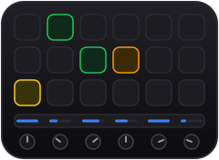
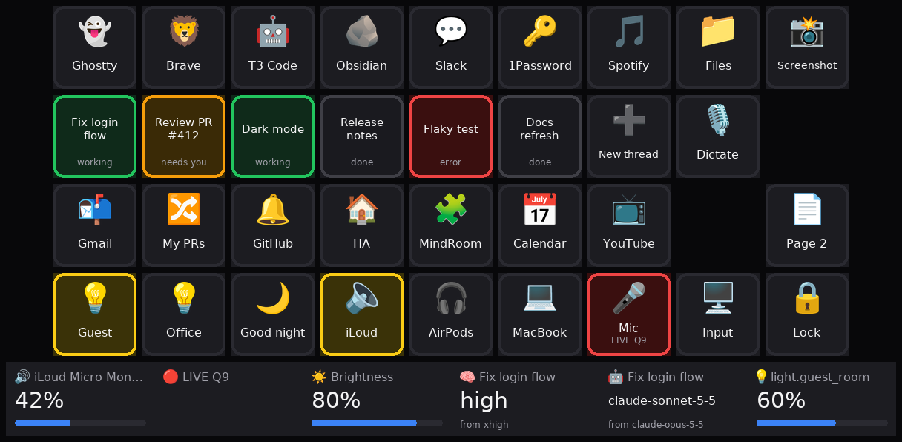
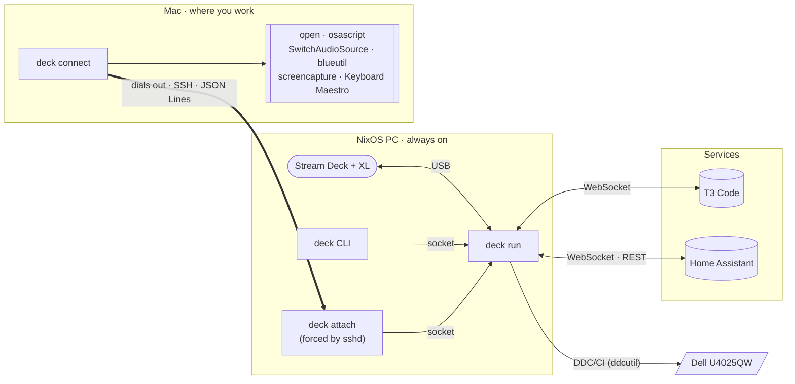

<div align="center">



# streamdeck

**A Stream Deck + XL control surface for an agentic desk.**

Watch and steer [T3 Code](https://t3.codes) agent threads, drive your Mac's apps, tabs and audio,
flip Home Assistant lights and dim the monitor — all from one YAML file.



<sub>Every pixel above comes from <code>deck render examples/full.yaml --state examples/state.json</code>.</sub>

</div>

---

> [!NOTE]
> This is a highly specific, vibe-coded setup for my own tools: one Stream Deck + XL, a NixOS PC,
> my Macs, T3 Code, Home Assistant and a Dell monitor. It is public in case the code or ideas are
> useful, not as a general-purpose product.

## Why

The deck is plugged into an always-on NixOS PC, but 99.9 % of the work happens on a Mac that
shares the same monitor. So the daemon runs next to the USB device and treats the Mac as a
**remote**: the Mac dials out to the PC over SSH, and that one long-lived connection, locked
down to an allowlist of actions, carries key presses to the Mac and its state back. Nothing
ever connects into a Mac, so a locked-down laptop can join too, and with two Macs the deck
acts on the one you touched last.

## Highlights

- 🤖 **Agent threads at a glance** — six keys mirror your most recent T3 Code threads, live over
  WebSocket: 🟢 working, 🟡 needs you, ⚪ done, 🔴 failed. Press one to open it in the existing
  Brave tab on the Mac.
- 🧠 **Model and effort dials that can't hit the wrong thread** — they act only on the thread
  open in Brave's front tab, re-checked at the moment you press.
- 🖥️ **Your Mac, from another computer** — open apps, focus-or-open browser tabs, take
  screenshots, run Keyboard Maestro macros, lock the screen. With several Macs, the keys act on
  the one with the latest keyboard or mouse input.
- 🎧 **Audio without the menu bar** — one key per output (Bluetooth connects on demand), mic
  mute with a live/muted indicator, an input guard against AirPods hijacking the mic.
- 💡 **Home Assistant** — toggle lights and scenes, keys light up with entity state, a dial for
  brightness.
- ☀️ **Monitor brightness over DDC/CI** — a dial on the PC side with one-press presets.
- 📝 **One YAML file** — validated as a whole with dotted error paths, hot-reloaded on save,
  rendered to PNG without any hardware.

## How it works



- **One package, two roles.** `deck run` owns the device, renders keys, and keeps a state store
  that providers (T3, Home Assistant, the Macs, DDC) push into. `deck connect` runs on each Mac,
  dials the PC and executes a fixed set of typed requests. On the PC, sshd runs `deck attach`
  for that connection, which hands it to the daemon.
- **Only small messages cross the network.** Rendering stays on the PC; the Mac sees requests such
  as `{"id": 7, "kind": "audio.output", "args": {...}}` and sends state diffs back once a second.
  The diffs include `idle_ms`, the milliseconds since its last keyboard or mouse input.
- **The Mac you used last is the active one.** The daemon follows the Mac with the latest input
  and mirrors its state into `mac.*`; requests go to it. `deck state` shows it as `mac.active`,
  and `mac.connected` lists every Mac that is online. A Mac going away never affects the other.
- **Everything degrades on its own.** If the Mac, Home Assistant or T3 goes away, their keys grey
  out and the clients reconnect with backoff while the rest of the deck keeps working.

## The dials

| Dial | Turn | Press | Strip shows |
|---|---|---|---|
| 🔊 `volume` | Mac output volume | mute | output device and % |
| 🎙️ `input` | cycle the preferred inputs that are present | mute the mic | `🔴 LIVE Q9` / `⚫ muted` |
| ☀️ `brightness` | monitor brightness (DDC VCP `0x10`) | next preset (default 35 / 80) | `80%` |
| 🧠 `t3.effort` | pick a reasoning effort for the thread in front | apply it | thread title, `high`, `from xhigh` |
| 🤖 `t3.model` | pick a model of that thread's provider | apply it | thread title, new model, old model |
| 💡 `ha.brightness` | light brightness in 5 % steps | toggle | `60%` / `off` |

Turning is shown at once and requests are coalesced, so a fast spin sends the first and the last
value rather than every tick.

## T3 Code: only the thread you're looking at

T3 Code lives in a Brave tab on the Mac, and the effort and model dials refuse to guess which
thread you mean:

1. **First turn** — the deck asks the Mac for the URL of the active tab in Brave's front window,
   parses `<environment id>/<thread id>` out of it, and shows `🧠 <thread title>` with the pending
   value. Further turns only step that value.
2. **Press** — the deck reads the URL *again* and applies the change with
   `thread.model-selection.set` only if it is still the very same thread, keeping the thread's
   provider instance and its other options.
3. **Anything uncertain changes nothing** and says why on the strip: `no T3 thread in front`,
   `thread changed — not applied`, `Mac offline — not applied`.

The URL is never polled, so there is no window in which a stale tab could pick the wrong thread.
Model lists are configured per provider instance, so the dial never offers a model the thread's
provider can't run.

## Quick start

```bash
git clone https://github.com/basnijholt/streamdeck && cd streamdeck
uv tool install .                     # provides the `deck` command

deck check examples/full.yaml         # validate: prints "ok" or every error with its path
deck render examples/full.yaml --state examples/state.json --png deck.png   # no hardware needed
deck run ~/.config/deck/config.yaml   # drive the real device
```

Python 3.13+. The PC needs `libhidapi` (on NixOS, put `${pkgs.hidapi}/lib` on
`LD_LIBRARY_PATH`) and, for brightness, a working `ddcutil`. The Mac only needs the package
installed (see [Setup](#setup)).

## Configuration

A config is one YAML file. Start from [`examples/config.yaml`](examples/config.yaml) (minimal)
or [`examples/full.yaml`](examples/full.yaml) (the layout pictured above); `deck schema` prints the
JSON schema for editor completion. The daemon reloads the file when it changes; an invalid edit
keeps the previous config and shows ❌ on key 0.

```yaml
pages:
  home:
    keys:                                   # up to 36, left to right, top to bottom; null = blank
      - {icon: "👻", label: Ghostty, press: {mac.app: Ghostty}}
      - {icon: "📬", label: Gmail, press: {mac.tab: {match: mail.google.com, url: "https://mail.google.com"}}}
      - icon: "💡"
        label: Guest
        state: {ha: light.guest_room}       # key lights up while the entity is on
        press: {ha: {service: light.toggle, entity_id: light.guest_room}}
      - {t3.slot: 0}                        # the most recently updated open T3 thread
    dials:                                  # up to 6
      - {kind: brightness}
      - {kind: t3.effort}
```

<details>
<summary><b>Sections</b></summary>

| Section | What it configures |
|---|---|
| `mac` | `{}`: no fields, the section turns on the hub that Macs dial in to |
| `home_assistant` | `url` and `token_env`, the environment variable holding a long-lived access token |
| `t3` | `servers` (API `url`, browser `web_url`, `environment_id`, `token_env`), `models` per provider instance, `efforts`, `effort_options` |
| `ddc` | `model` of the monitor to find among `ddcutil detect` results |
| `audio` | `outputs` (`name`, `match` substring, optional Bluetooth `bt` address), preferred `inputs`, `pin_input` |
| `pages` | named pages of `keys` and `dials`; `start_page` picks the first (default `home`) |

Sections are optional, but anything that uses one (a `mac.*` key, a `brightness` dial) makes it
required. Tokens are read from the environment, never from the YAML.

</details>

<details>
<summary><b>Keys</b></summary>

| Field | Meaning |
|---|---|
| `icon` | emoji or text drawn large |
| `label` | text under the icon |
| `press` | action on a short press |
| `long_press` | action when held for 0.5 s or more (falls back to `press`) |
| `state` | `{ha: <entity_id>}`: light up while the entity is on, dim while it is unavailable |
| `t3.slot` | `0`–`5`: show that thread slot; pressing opens the thread |

Keys whose action is running for more than 0.4 s show ⏳; a failed action flashes the key red.

</details>

<details>
<summary><b>Actions</b></summary>

Each action is a single-key mapping: `{<type>: <arguments>}`.

| Type | Arguments | Does |
|---|---|---|
| `page` | page name | switch page |
| `shell` | argv list | run a command on the PC |
| `ddc` | `{code, value}` | set any DDC/CI VCP feature (for example input source `0x60`) |
| `ha` | `{service, entity_id, data?}` | call a Home Assistant service |
| `t3.focus` | slot `0`–`5` | open that thread in the Mac's T3 tab |
| `t3.new` | — | open the T3 web UI |
| `mac.app` | app name | `open -a` it |
| `mac.url` | http(s) URL | open it |
| `mac.tab` | `{match, url, navigate?}` | focus the first Brave tab whose URL contains `match` (`navigate: true` also loads `url` in it), else open `url` in a new tab |
| `mac.audio.output` | `{name, disconnect?}` | switch output, connecting Bluetooth first if needed (≤10 s) |
| `mac.audio.input` | device name | switch input |
| `mac.mic.mute` | — | toggle mic mute |
| `mac.volume` | `{mute: toggle}` | toggle output mute |
| `mac.screenshot` | — | interactive screenshot to the clipboard |
| `mac.km` | macro name or UUID | run a Keyboard Maestro macro |
| `mac.script` | file name | run an executable from `~/.config/deck/scripts/` on the Mac |
| `mac.lock` | — | sleep the display (locks if a password is required) |

`mac.*` actions run on the active Mac: the connected one with the most recent keyboard or mouse
input. While no Mac is connected, `mac.*` keys render greyed with 🚫 and presses are dropped
rather than queued.

</details>

<details>
<summary><b>Audio</b></summary>

- **Output keys** light up while their device is the current output. A press connects the
  Bluetooth device if it has a `bt` address and is not connected, waits for it to appear, then
  switches. A long press with `disconnect: true` disconnects it.
- **Input guard** — when AirPods connect, macOS moves the input to the AirPods mic, which drops
  Bluetooth to call quality. The 🎤 key gets an amber border whenever the input is not the first
  available entry of `audio.inputs`; `pin_input: true` re-applies the preferred input
  automatically after device changes.
- **Mic mute** sets the input volume to 0 and restores it, so the muted state can be read back;
  devices without a software input volume fall back to a CoreAudio mute.

</details>

## Setup

<details>
<summary><b>PC (NixOS)</b></summary>

```nix
# The deck for the `users` group, with or without a desktop session (uaccess needs one).
services.udev.extraRules = ''
  KERNEL=="hidraw*", ATTRS{idVendor}=="0fd9", MODE="0660", GROUP="users"
  SUBSYSTEM=="usb", ATTRS{idVendor}=="0fd9", MODE="0660", GROUP="users"
'';
hardware.i2c.enable = true;                  # ddcutil: also add yourself to the `i2c` group
users.users.basnijholt.linger = true;       # start the user service at boot

systemd.user.services.deck = {
  wantedBy = [ "default.target" ];
  path = [ pkgs.ddcutil ];
  environment.LD_LIBRARY_PATH = "${pkgs.hidapi}/lib";
  environment.SSL_CERT_FILE = "/etc/ssl/certs/ca-certificates.crt";  # uv's Python looks for /etc/ssl/cert.pem
  serviceConfig = {
    ExecStart = "%h/.local/bin/deck run %h/.config/deck/config.yaml";
    EnvironmentFile = "%h/.config/deck/secrets.env";   # HA_TOKEN=…, T3_TOKEN=…
    Restart = "always";
  };
};
```

The PC needs nothing else for the Macs: each one adds a line to your `~/.ssh/authorized_keys`
(see **Mac**). `deck attach` finds the daemon's socket through `$XDG_RUNTIME_DIR`, which NixOS's
sshd sets for every session (`pam_systemd`).

</details>

<details>
<summary><b>Mac</b></summary>

Every Mac gets its own key and its own name (`macbook` below).

1. Install the tools: `brew install switchaudio-osx blueutil`, and the package with
   `uv tool install`.
2. Make a key that the Mac uses only for this. `deck connect` offers ssh only this key
   (`IdentitiesOnly`) and ignores the keys in your agent:

   ```bash
   mkdir -p ~/.config/deck
   ssh-keygen -t ed25519 -f ~/.config/deck/pc_ed25519 -N ""
   ```

3. On the PC, add the Mac's public key (`~/.config/deck/pc_ed25519.pub`) to `~/.ssh/authorized_keys`,
   pinned to `deck attach` under the Mac's name and to your LAN:

   ```
   command="/home/basnijholt/.local/bin/deck attach macbook",restrict,from="192.168.1.0/24" ssh-ed25519 AAAA… deck@macbook
   ```

4. Trust the PC's host key now: `deck connect` runs ssh with `BatchMode=yes`, which cannot ask,
   so without this its first connect fails with `Host key verification failed.`

   ```bash
   ssh-keyscan -H 192.168.1.5 >> ~/.ssh/known_hosts
   ```

5. Keep `deck connect` running as a LaunchAgent in your login session, so AppleScript,
   `screencapture` and Bluetooth run as you. Save this as
   `~/Library/LaunchAgents/nl.nijho.deck.plist`:

   ```xml
   <?xml version="1.0" encoding="UTF-8"?>
   <!DOCTYPE plist PUBLIC "-//Apple//DTD PLIST 1.0//EN" "http://www.apple.com/DTDs/PropertyList-1.0.dtd">
   <plist version="1.0">
   <dict>
     <key>Label</key>
     <string>nl.nijho.deck</string>
     <key>ProgramArguments</key>
     <array>
       <string>/Users/you/.local/bin/deck</string>
       <string>connect</string>
       <string>basnijholt@192.168.1.5</string>
       <string>--key</string>
       <string>/Users/you/.config/deck/pc_ed25519</string>
     </array>
     <key>RunAtLoad</key>
     <true/>
     <key>KeepAlive</key>
     <true/>
     <key>ProcessType</key>
     <string>Interactive</string>
     <key>StandardErrorPath</key>
     <string>/tmp/deck.log</string>
   </dict>
   </plist>
   ```

   and load it with `launchctl bootstrap gui/$(id -u) ~/Library/LaunchAgents/nl.nijho.deck.plist`.
   `ProcessType` `Interactive` keeps launchd from throttling the once-a-second poll. If the PC is
   down or the daemon is not running, `deck connect` retries with backoff (1 s up to 30 s) and
   logs to `/tmp/deck.log`.
6. Press a Brave tab key and a Keyboard Maestro key once each, and accept the macOS Automation
   prompts. They name the Python that runs `deck`.
7. Optional: put executable scripts for `mac.script` in `~/.config/deck/scripts/`.

Two `deck connect`s under the same name keep replacing each other, so never share a key between
Macs. Coming from the old PC-to-Mac setup, delete the PC's `mac_ed25519` key and the Mac's
`deck remote` line in `authorized_keys`.

</details>

<details>
<summary><b>Tokens</b></summary>

- **T3 Code:** `t3 auth session issue --scope orchestration:read --scope orchestration:operate --label streamdeck --ttl 365d --token-only`
- **Home Assistant:** Profile → Security → Long-lived access tokens.

Put both in the `EnvironmentFile` under the names your config's `token_env` fields use.

</details>

## CLI

| Command | Does |
|---|---|
| `deck run CONFIG` | run the daemon |
| `deck check CONFIG` | validate a config; prints `ok` or one `dotted.path: message` per problem |
| `deck render CONFIG --png OUT [--page P] [--state STATE.json]` | render a page to PNG, optionally with fake state |
| `deck schema` | print the config's JSON schema |
| `deck reload` | make the running daemon reload its config now |
| `deck state` | dump the running daemon's state as JSON |
| `deck press PAGE KEY [--long]` | press a key of the running daemon |
| `deck connect DESTINATION [--key PATH]` | on a Mac: dial out to the PC with `ssh` and serve its requests, reconnecting forever (run by launchd) |
| `deck attach NAME` | on the PC: relay a Mac's SSH connection to the daemon as `NAME` (run by sshd, not by hand) |

`deck reload`, `deck state` and `deck press` talk to the daemon over a `0600` Unix socket at
`$XDG_RUNTIME_DIR/deck.sock`, so scripts and agents on the PC can drive the deck too.

## Security

🔒 Every Mac dials out, so nothing can SSH into a Mac, and the PC holds no key that can make a Mac
do anything.

- Each Mac has its own key. Its `authorized_keys` entry on the PC forces `deck attach <name>` and
  adds `restrict` (no shell, PTY, or port forwarding), and `from=` pins it to the LAN. The key
  can attach only under its own name.
- `deck attach` relays to a `0600` Unix socket of the daemon, so only processes of your user on the
  PC can attach: the same trust as the control socket.
- A Mac executes only the typed action kinds above. `mac.url` takes only http(s) URLs,
  `mac.script` runs only files already in the scripts directory, and there is no generic shell.
- AppleScript arguments go through `on run argv` and are never spliced into script text.
- The control socket exposes no Mac execution, and tokens live in the environment, not in the
  config.

Accepted risk: whoever holds a Mac's key can pose as that Mac. They can claim constant input to
become the active Mac, see which apps, URLs and tabs the deck sends, and feed it false state. They
cannot run anything on the PC or on the other Mac. That is fine on a home LAN.

## Development

```bash
uv sync
uv run pytest                 # runs without a deck, a Mac, T3 or Home Assistant
```

The tests use a fake device, a fake command runner, fake Macs that dial in over a real socket, and
recorded (sanitized) T3 Code protocol fixtures. Protocol notes are in
[`docs/t3-protocol.md`](docs/t3-protocol.md), and the design and plan in
[`docs/baspowers/`](docs/baspowers/).

## Roadmap

- **Hardware approval gate** — an agent's risky command lights an Approve key; a physical press
  allows it, a long press or timeout denies it.
- `deck ask "<question>" --yes --no` for agents.
- New thread with the clipboard as the prompt.
- Context pages that follow the Mac's frontmost app.
- CI and pull request status keys.

## License

[MIT](LICENSE)
